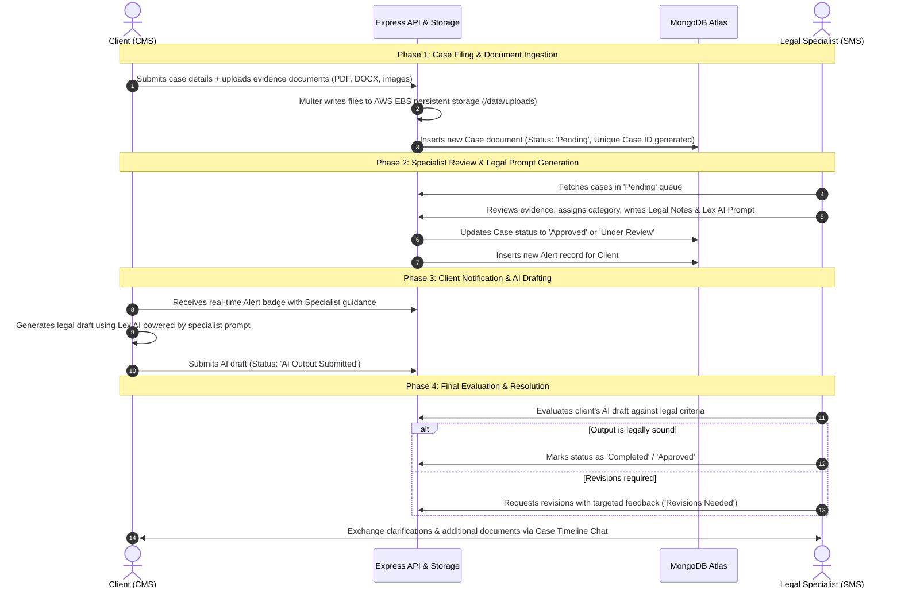

# Legal Portal Suite — Complete User Manual, Architecture & Technical Guide

---

## 📑 Table of Contents
1. [Project Overview](#1-project-overview)
2. [Skills & Technology Stack](#2-skills--technology-stack)
3. [Comprehensive Folder Structure](#3-comprehensive-folder-structure)
4. [How the System Works (System Architecture & Case Lifecycle)](#4-how-the-system-works-system-architecture--case-lifecycle)
5. [User Manual & Step-by-Step Instructions](#5-user-manual--step-by-step-instructions)
   - [A. CMS (Client Management System) User Guide](#a-cms-client-management-system-user-guide)
   - [B. SMS (Specialist Management System) User Guide](#b-sms-specialist-management-system-user-guide)
   - [C. Admin & Maintenance Features](#c-admin--maintenance-features)
6. [Backend REST API Reference](#6-backend-rest-api-reference)
7. [Local Setup & Development Guide](#7-local-setup--development-guide)
8. [Live Production Deployment Information](#8-live-production-deployment-information)

---

## 1. Project Overview

The **Legal Portal Suite** is a full-stack, enterprise-grade legal case management and specialist review platform. It bridges the communication gap between citizens/clients and legal subject-matter specialists (lawyers and legal SMEs) through a streamlined, AI-assisted review process.

The platform is comprised of three core services:

1. **CMS (Client Management System)**:
   - Dedicated front-end portal for clients/litigants.
   - Allows users to register/log in, file new legal cases, and upload evidence documents (PDF, DOCX, images).
   - Real-time case tracking, timeline audit logs, interactive chat with legal specialists.
   - Lex AI output drafting and submission for legal scrutiny.

2. **SMS (Subject Matter Specialist System)**:
   - Dedicated front-end dashboard for legal specialists, advocates, and reviewers.
   - Allows legal specialists to inspect queued cases, categorize legal domains, add formal legal notes, and generate tailored prompts for Lex AI.
   - Comprehensive review workflow for client-submitted AI outputs (Approval, Revision requests, or Final Completion).
   - Case timeline chat with clients for real-time clarification.

3. **Backend API Service**:
   - High-throughput Node.js & Express RESTful microservice.
   - Backed by **MongoDB Atlas** for document persistence and indexing.
   - High-performance **AWS EBS (Elastic Block Store)** disk filesystem for media and evidence storage.

---

## 2. Skills & Technology Stack

The following competencies and technical skills are utilized throughout this project:

| Category | Technology / Skill | Purpose & Implementation |
| :--- | :--- | :--- |
| **Frontend Framework** | **React.js (v18+)** | Component-driven architecture, modular state management, hooks (`useState`, `useEffect`, `useRef`). |
| **Build & Bundling** | **Vite** | Lightning-fast development server with Hot Module Replacement (HMR) and optimized production bundles. |
| **Styling & UI Design** | **Custom Vanilla CSS** | Modern UI design system: glassmorphism, responsive CSS grids, CSS variables, dark themes, and micro-interactions. |
| **Backend Runtime** | **Node.js & Express.js** | Non-blocking asynchronous RESTful APIs, request routing, middleware authentication, and error handling. |
| **Database & Modeling** | **MongoDB Atlas & Mongoose ODM** | Cloud document database, schema definitions, query optimization, indexing, and data validation. |
| **File Storage & Uploads** | **Multer & AWS EBS Volume** | Multipart form-data handling, disk storage management, and automatic Base64-to-disk conversion. |
| **DevOps & Cloud** | **AWS EC2 (Ubuntu Linux)** | Cloud infrastructure management, Elastic IP (`13.202.10.28`), security groups, and storage mounting. |
| **Web Server & Security** | **Nginx & Let's Encrypt** | Reverse proxy routing (`Port 443 -> Port 5000`), automated TLS/SSL certificate issuance and renewal via `sslip.io`. |
| **Process Management** | **PM2** | Production cluster process daemon, zero-downtime reloads, and centralized runtime logs. |
| **Scripting & Automation** | **PowerShell & Bash** | Automated deployment pipelines (`deploy.ps1`, `setup_ec2.sh`, `nginx_ssl.py`). |

---

## 3. Comprehensive Folder Structure

```text
legal-portal/
│
├── package.json               # Root monorepo workspace configuration and unified scripts
├── package-lock.json          # Root dependency lockfile
├── README.md                  # Quick project summary
├── USER_MANUAL.md             # Complete user manual, architecture, and guide (this document)
│
├── backend/                   # Node.js + Express REST API server
│   ├── .env                   # Local environment variables (PORT, MONGODB_URI, etc.)
│   ├── .env.example           # Environment template file
│   ├── .env.production        # Production environment configuration (AWS EC2 / EBS)
│   ├── .gitignore             # Backend git ignore rules
│   ├── package.json           # Backend dependencies and startup scripts
│   ├── server.js              # Express application root, API endpoints, and middleware
│   ├── db.js                  # MongoDB Atlas connection manager with retry logic
│   ├── upload.js              # Multer configuration and Base64-to-EBS disk conversion logic
│   ├── migrate_db.js          # Database migration utility (JSON/legacy storage to MongoDB)
│   │
│   ├── models/                # Mongoose database models & schemas
│   │   ├── User.js            # CMS Client User schema (clientId, name, password)
│   │   ├── SmsUser.js         # SMS Specialist User schema (smsId, position, password, profile)
│   │   ├── Case.js            # Comprehensive case schema (details, files, chats, status, AI outputs)
│   │   └── Alert.js           # Notification alerts schema for real-time client updates
│   │
│   ├── uploads/               # Disk storage directory for uploaded files (EBS mount location)
│   │
│   └── deploy/                # Cloud deployment automation scripts
│       ├── deploy.ps1         # Automated remote deployment PowerShell script
│       ├── ecosystem.config.cjs # PM2 configuration file for backend process daemon
│       ├── nginx_ssl.py       # Python automation script for Nginx SSL with sslip.io
│       └── setup_ec2.sh       # Initial EC2 instance bootstrapping script
│
├── cms/                       # Client Management System (React + Vite)
│   ├── index.html             # HTML root document with responsive viewport
│   ├── vite.config.js         # Vite configuration and proxy setup
│   ├── package.json           # CMS dependencies and scripts
│   └── src/                   # CMS application source code
│       ├── main.jsx           # React DOM application entry point
│       ├── App.jsx            # Core application component, global state, and view routing
│       ├── api.js             # HTTP client for backend REST API communication
│       ├── index.css          # Design system, glassmorphism tokens, and responsive layout CSS
│       │
│       ├── components/        # Reusable React components
│       │   ├── Auth/
│       │   │   └── AuthModal.jsx        # Client login, registration, and password reset modal
│       │   ├── Dashboard/
│       │   │   ├── CMSDashboard.jsx     # Case creation form and primary dashboard view
│       │   │   ├── CasesTracker.jsx     # Case tracking cards and filterable list
│       │   │   ├── CaseTimelineModal.jsx # Detailed case timeline, evidence preview, and chat
│       │   │   └── AlertModal.jsx       # Real-time specialist feedback notification modal
│       │   └── Layout/
│       │       ├── Sidebar.jsx          # App navigation, identity panel, and profile switcher
│       │       └── ProfileModal.jsx     # Client profile details and password change modal
│       └── hooks/                       # Custom React utility hooks
│
└── sms/                       # Subject Matter Specialist System (React + Vite)
    ├── index.html             # HTML root document
    ├── vite.config.js         # Vite configuration and development port settings
    ├── package.json           # SMS dependencies and scripts
    └── src/                   # SMS application source code
        ├── main.jsx           # React DOM application entry point
        ├── App.jsx            # Main specialist dashboard orchestration component
        ├── api.js             # SMS API client adapter
        ├── index.css          # Modern dark-themed styling for legal specialists
        │
        ├── components/
        │   ├── Auth/
        │   │   └── SMSLogin.jsx         # Specialist login, authentication, and registration
        │   └── Dashboard/
        │       ├── SMSDashboard.jsx     # Queue manager for pending, reviewed, and active cases
        │       ├── CaseReviewModal.jsx  # Specialist case review, legal notes, and AI prompt input
        │       ├── CaseTimelineModal.jsx # Case history, client chat, and attachment viewer
        │       └── SMSProfileModal.jsx  # Specialist profile settings and security management
        └── hooks/                       # Specialist React utility hooks
```

---

## 4. How the System Works (System Architecture & Case Lifecycle)

The system manages a complete legal dispute lifecycle from initial client filing through legal evaluation, AI drafting, and final specialist approval.

### Case Lifecycle & Sequence Diagram



---

## 5. User Manual & Step-by-Step Instructions

### A. CMS (Client Management System) User Guide

#### 1. Account Registration & Authentication
- **Registration**:
  1. Open the CMS portal in your browser.
  2. Click **Register** on the modal.
  3. Provide a unique **Client ID** (e.g., `CLI-101`), your full name, and a secure password.
  4. Submit to create your account; you will be automatically logged in.
- **Login**:
  1. Enter your registered `Client ID` and password.
  2. Click **Login** to access your dashboard.
- **Forgot Password**:
  1. If you forget your credentials, click **Forgot Password**, supply your `Client ID`, and enter a new temporary password.

#### 2. Filing a New Legal Case
1. Navigate to the **"File New Case"** tab on the dashboard.
   - **Applicant / Entity Type**: Choose between **Individual** (with title/salutation: Mr., Ms., Mrs., Dr., Adv., Prof., CA) or **Institute** (Organization name).
   - **Full Name / Institute Name**: Legal name of the petitioner, applicant, or institution.
   - **City & State**: Geographical jurisdiction.
   - **Case Vertical**: Select vertical (**MSME/A&C related**, **Service Matter related**).
   - **Case Category**: Select category (**Deputation Related**, **Pension Issues**, **Promotion Disputes**, **Departmental Matters and Inquiries**, **Disciplinary Actions**).
   - **Case Brief**: 1–2 lines describing the main issue.
   - **Case Summary (Optional)**: Detailed factual background, dispute timeline, or full case narrative.
   - **Upload Evidence**: Attach supporting documents (contracts, notices, police complaints, photographs). Maximum 10 files per submission.
3. Click **"Submit Case"**. The system will assign an immutable, unique sequential ID (e.g., `CASE-01`).

#### 3. Tracking Cases & Real-time Alerts
1. Open the **"My Cases"** tab to view your filed cases.
2. Each case card indicates its current stage:
   - `Pending`: Waiting for a specialist to pick up the case.
   - `Approved` / `Under Review`: A legal specialist has reviewed the case and prepared notes.
   - `AI Output Submitted`: Your Lex AI draft has been sent to the specialist for scrutiny.
   - `Completed`: Final legal approval has been granted.
3. **Alerts Bell Icon**:
   - Whenever a specialist submits notes, responds in chat, or reviews your draft, a red notification badge will appear.
   - Click the bell icon to open the **Alerts Modal** and review the structured feedback.

#### 4. Interactive Timeline & Specialist Chat
1. Click **"View Timeline"** on any case card.
2. You will see a chronological activity log of every status change and review.
3. Use the integrated **Chat Panel** at the bottom to send real-time text messages and upload additional evidence files directly to the assigned specialist.

#### 5. Lex AI Legal Drafting Workflow
1. Once the specialist reviews your case, they will generate a **Lex AI Prompt** customized to your legal situation.
2. Review the specialist's notes and launch the **Lex AI** view.
3. Generate the required legal draft (e.g., legal notice, affidavit, or petition).
4. Click **"Submit Lex Output to SMS"**. The status will change to `AI Output Submitted`, notifying the specialist to perform final legal verification.

---

### B. SMS (Specialist Management System) User Guide

#### 1. Specialist Registration & Authentication
- **Specialist Login**:
  1. Open the SMS portal.
  2. Enter your **SMS ID** (e.g., `SME-LEGAL-01`) and password.
- **Specialist Registration**:
  1. If creating a new specialist account, provide an `SMS ID`, your professional designation (e.g., *Senior Corporate Counsel*), and password.
  2. *Security Requirement*: Passwords must be at least 6 characters long and include letters, numbers, and symbols (`@$!%*#?&`).

#### 2. Specialist Dashboard & Pending Review Queue
1. Upon logging in, the **Pending Cases Queue** displays all newly filed cases awaiting legal assessment.
2. Sort and filter cases by date, category, or search keywords.
3. Click **"Review Case"** on any card to begin the review workflow.

#### 3. Conducting a Case Review
1. The **Case Review Modal** presents the client's information, statement, and downloadable evidence files.
2. Complete the legal review form:
   - **Category**: Confirm or correct the legal domain classification.
   - **Status**: Update to `Approved` or `Under Review`.
   - **Specialist Legal Notes**: Provide comprehensive legal opinions, statute references, and instructions for the client.
   - **Lex AI Prompt**: Craft the structured prompt that the client will use in the Lex AI module.
3. Click **"Submit Review"**. This immediately generates a notification alert for the client.

#### 4. Final Evaluation of Client AI Output
1. Cases where clients have submitted their drafts will display the status `AI Output Submitted`.
2. Open the case to inspect the client's **Lex AI Output**.
3. Evaluate the output:
   - **Approve**: If the document meets legal standards, set the status to `Completed` or `Approved`.
   - **Request Revisions**: If clauses require amendment, select `Revisions Needed` and provide explicit revision instructions.

#### 5. Specialist Chat & Case Finalization
1. Open the **Case Timeline / Chat** modal to answer client queries or request missing documentation.
2. Once all legal requirements are satisfied, provide your specialist password to confirm and trigger **"Mark Case as Completed"**.

---

### C. Admin & Maintenance Features

1. **System Health Endpoint**:
   - `GET /api/health`: Provides JSON diagnostic data including server uptime, timestamp, EBS upload directory status, and database health.
2. **Data Cleanup Utility (`POST /api/admin/clean-data`)**:
   - Designed for staging and testing environments.
   - Completely flushes all test cases, notification alerts, and uploaded files from the EBS volume.
   - **Preserves credentials**: User and specialist authentication accounts remain intact, allowing immediate subsequent testing without re-registering.

---

## 6. Backend REST API Reference

| HTTP Method | Endpoint Path | Description | Access / Roles |
| :--- | :--- | :--- | :--- |
| `GET` | `/api/health` | Diagnostic status of API, MongoDB, and EBS storage | Public |
| `POST` | `/api/upload` | Multipart file upload; saves files to AWS EBS storage | Authenticated |
| `POST` | `/api/auth/register` | Register new CMS client account | Public |
| `POST` | `/api/auth/login` | Authenticate CMS client credentials | Public |
| `POST` | `/api/auth/change-password` | Update existing CMS client password | CMS Client |
| `POST` | `/api/auth/forgot-password` | Reset forgotten password with temporary credentials | CMS Client |
| `POST` | `/api/sms/auth/register` | Register new legal specialist account | Public / Admin |
| `POST` | `/api/sms/auth/login` | Authenticate SMS specialist credentials | Public |
| `POST` | `/api/sms/auth/change-password` | Update specialist password | Specialist |
| `GET` | `/api/cases` | List cases (optionally filtered by `clientId` query param) | Client / Specialist |
| `GET` | `/api/cases/:id` | Fetch full case record by unique case ID | Client / Specialist |
| `POST` | `/api/cases` | File and ingest a new legal case | CMS Client |
| `DELETE` | `/api/cases/:id` | Delete a case by ID | Specialist / Admin |
| `POST` | `/api/cases/:id/review` | Submit specialist review verdict and directives | Specialist |
| `POST` | `/api/cases/:id/lex-output` | Submit client-generated Lex AI output | CMS Client |
| `POST` | `/api/cases/:id/final-review` | Submit final evaluation of AI draft (Approve/Revise) | Specialist |
| `POST` | `/api/cases/:id/chat` | Send a timeline chat message and file attachments | Client / Specialist |
| `POST` | `/api/cases/:id/mark-read` | Mark all alerts and messages as read by CMS client | CMS Client |
| `POST` | `/api/cases/:id/mark-sms-read` | Mark all chat messages as read by SMS specialist | Specialist |
| `POST` | `/api/cases/:id/complete` | Complete case with specialist password verification | Specialist |
| `GET` | `/api/alerts` | Fetch recent notification alerts | CMS Client |
| `POST` | `/api/alerts/:id/read` | Mark a specific alert as read | CMS Client |
| `POST` | `/api/alerts/mark-all-read` | Mark all notifications as read | CMS Client |
| `POST` | `/api/admin/clean-data` | Purge cases, alerts, and upload files while preserving logins | Admin |

---

## 7. Local Setup & Development Guide

### Prerequisites
- [Node.js](https://nodejs.org/) (Version 18 or higher)
- [npm](https://www.npmjs.com/) (Version 9 or higher)
- Stable internet connection for MongoDB Atlas access

### Step 1: Install Dependencies
Run the install command from the root workspace to install all sub-project dependencies:
```bash
npm install
```

Or install inside each sub-folder individually:
```bash
cd backend && npm install
cd ../cms && npm install
cd ../sms && npm install
```

### Step 2: Environment Configuration
Verify that `backend/.env` exists and contains your database connection string:
```env
PORT=5000
MONGODB_URI=mongodb+srv://<username>:<password>@cluster0.bdwezjh.mongodb.net/legal_portal?retryWrites=true&w=majority
UPLOAD_DIR=./uploads
```

### Step 3: Running the Application Services

You can start each service using the monorepo root scripts:

```bash
# Start Backend (Port 5000)
npm run dev:backend

# Start CMS Client Portal (Port 5173)
npm run dev:cms

# Start SMS Specialist Portal (Port 5174)
npm run dev:sms
```

Alternatively, run in separate terminal windows:
1. **Terminal 1 (Backend)**:
   ```bash
   cd backend
   npm start
   ```
2. **Terminal 2 (CMS)**:
   ```bash
   cd cms
   npm run dev
   ```
3. **Terminal 3 (SMS)**:
   ```bash
   cd sms
   npm run dev
   ```

---

## 8. Live Production Deployment Information

| Parameter | Configuration Details |
| :--- | :--- |
| **Production API Endpoint** | [https://13-202-10-28.sslip.io/api/health](https://13-202-10-28.sslip.io/api/health) |
| **AWS EC2 Elastic IP** | `13.202.10.28` (Region: `ap-south-1` Mumbai) |
| **TLS / SSL Certificate** | Automated Let's Encrypt Certificate via `sslip.io` wildcard DNS |
| **Web Server / Reverse Proxy**| Nginx Reverse Proxy (Routes public HTTPS port 443 to internal port 5000) |
| **Process Daemon** | PM2 Process Manager (`pm2 status`, `pm2 logs`) |
| **Database** | MongoDB Atlas Cloud Cluster (`legal_portal` database) |
| **Persistent Storage** | AWS EBS Volume mount at `/data/legal_portal/uploads` |

---

> **Proprietary Notice**:
> Legal Portal Suite © C-NET TEAM. All Rights Reserved.
